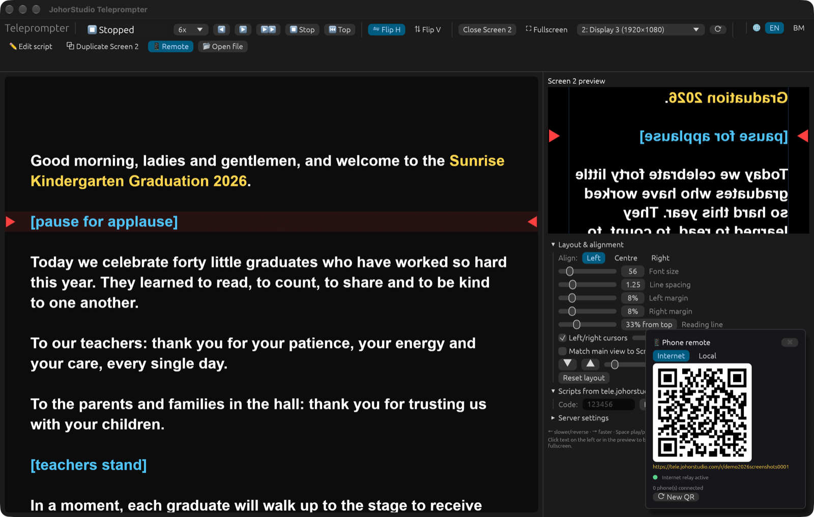
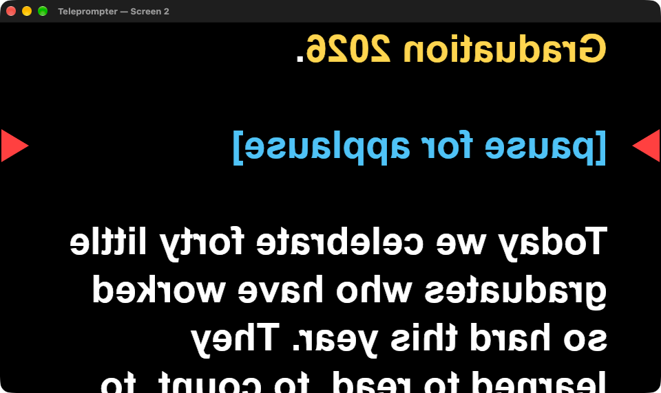
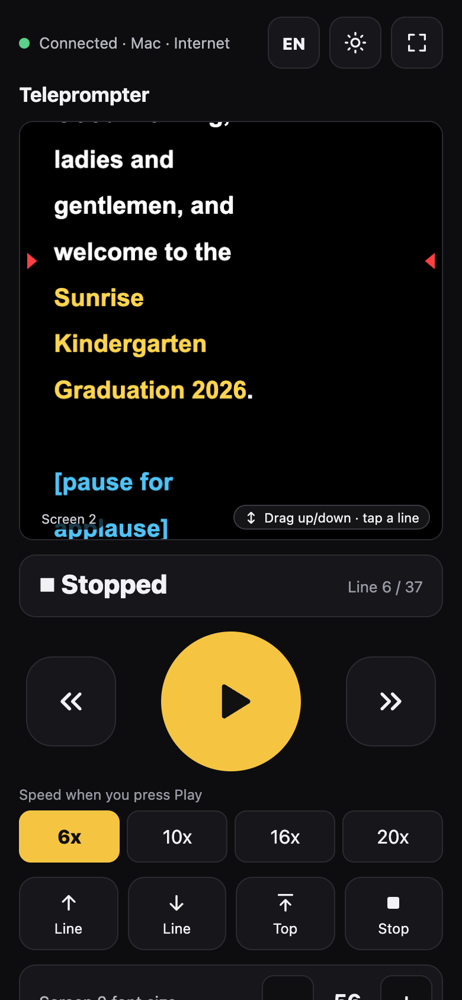
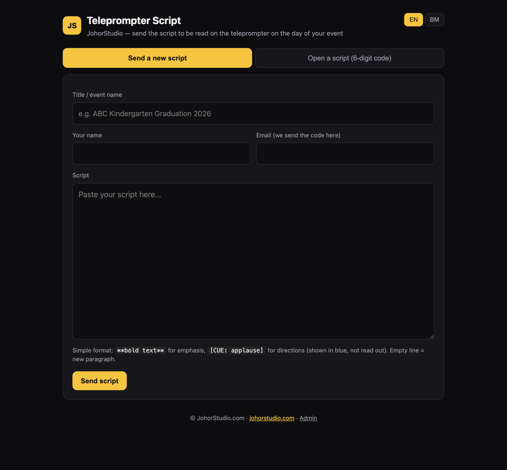

# JohorStudio Teleprompter

A two-screen presidential teleprompter for events, written in Rust (egui). Runs on macOS today; Windows is next.
The operator drives everything from the main screen (or a phone). Screen 2 shows the mirrored script on the glass.
English by default; switch to Bahasa Melayu with **🌐 EN | BM** at the top right of the app, the phone remote and the web pages.



## What's in the box

| Part | What it does |
|---|---|
| **Mac app** | Main window: script (left ⅔) and a live preview of Screen 2 with all controls (right ⅓). Screen 2: a fullscreen prompter window on the second display. |
| **Phone remote** | Scan the QR in the app: play/pause, speed, line up/down, font size, pick scripts. Works over the internet (no app, no VPN) or locally. |
| **tele.johorstudio.com** | Clients send their script and get a 6-digit code by email; they can edit it until the event. A protected `/admin` page lists and deletes scripts. |

## Screen 2 (prompter)

Black background, white text, mirrored for the glass (**⇋ Flip H** / **⇅ Flip V**). The line to read sits at ⅓ from the
top, between red cursors on the left and right. Bold text (`**…**`) is yellow; cues (`[CUE: …]`) are blue and not read out.



## Main window

- **Click any line** in the script (or in the preview) and Screen 2 glides to it (ease in/out, no jump), so the
  speaker's eyes can follow.
- **Space** plays at the default speed (dropdown next to ◀, default 6x) or pauses. **→** faster, **←** slower or reverse,
  **↑/↓** one line, **Home** back to the top, **Esc** stop.
- **Layout & alignment**: left/centre/right, font size, line spacing, margins, reading-line position, cursor size.
- The left pane holds the current line still and eases to the next one, so it never jitters.
  **⧉ Duplicate Screen 2** makes it a 1:1 copy of Screen 2 (same lines and motion).
- Main text size up to 100 (▲/▼).
- Scripts load from a `.txt` file, from **📂 Open file**, or from tele.johorstudio.com by code. The server list
  (**⟳ List**) can also delete scripts (🗑 with confirmation).

## Phone remote



Click **📱 Remote** and scan the QR card at the bottom right of the main window. Nothing to install on the phone.

- **Internet**: `https://tele.johorstudio.com/r/<session>`. The Mac app connects *out* to a relay on the script
  server, so the phone can be on any network (mobile data, venue Wi-Fi) without Tailscale. HTTPS, so
  keep-screen-on and fullscreen work. **⟳ New QR** starts a new session and cuts off old phones.
- **Local**: `http://<mac-ip>:8140` over Tailscale (100.x) or the same Wi-Fi; works with no internet.

On the phone:

- The Screen 2 preview draws exactly the same lines as Screen 2. **Drag** it to move the text, **tap** a line to
  glide to it.
- Big Play/Pause, slower/faster, default speed (6x, 10x, 16x, 20x), line up/down, Top, Stop, Screen 2 font size.
- **Scripts**: list the scripts on tele.johorstudio.com and tap one to load it; **⟳ Reload script** fetches the latest
  version of the current script and keeps the position.
- ☀ keeps the phone screen on, ⛶ goes fullscreen, **EN/BM** switches language (saved on that phone).

Anyone with the QR link can drive the prompter, so press **⟳ New QR** after a client has used it.
Local mode has no password: anyone on the same Tailscale network or Wi-Fi can reach it.

<br clear="right">

## Script server: tele.johorstudio.com



- Clients send a title, their name, email and the script. They get a 6-digit code on screen and by email
  (in the language they chose), and can open and edit the script with it. **Forgot the code?** emails all their codes.
- `/admin` (Cloudflare Access, owner only; the server also verifies the Access token) lists, searches and deletes
  scripts, one or many, with an "older than 7/30/90 days" filter.
- `/r/<session>` serves the phone remote and `/relay/{mac,phone}/<session>` is the WebSocket relay
  (max 10 phones per session).

It's a small Python app (standard library only) with SQLite, running as the TrueNAS custom app `teleprompter`
(`deploy/truenas-app.yaml`, data in `/mnt/ssd/teleprompter`), published through the Cloudflare tunnel.
Settings live in `/mnt/ssd/teleprompter/.env` (see `deploy/.env.example`).

## Download

From [Releases](../../releases):

- **Mac (Apple Silicon)**: `JohorStudio-Teleprompter-mac-arm64.zip`. Unzip and move **JohorStudio Teleprompter.app**
  to Applications. The app isn't notarized: the first time, right-click it → **Open** → **Open**. If macOS asks to
  allow incoming connections, click **Allow** (needed for the Local remote).
- **Windows (64-bit)**: `JohorStudio-Teleprompter-windows-x64.zip`. Unzip and run **JohorStudio Teleprompter.exe**.
  The exe isn't signed: if SmartScreen warns, click **More info** → **Run anyway**. Allow it through the Windows
  firewall on private networks for the Local remote.

The Windows zip is built on a Windows machine by GitHub Actions (`.github/workflows/windows.yml`) whenever a release
is published.

## Build

```sh
cargo build --release              # binary in target/release
./scripts/make-mac-app.sh install  # build the .app into dist/ and copy it to /Applications
```

`JS_TELE_DATA_DIR=/some/folder` runs the app with a separate settings/script folder (demo, screenshots, a second operator).

## Project layout

```
src/main.rs      app, prompter window, controls
src/draw.rs      mirrored text, cursors, row mapping between views
src/markup.rs    **bold** / [CUE: …] parsing
src/remote.rs    phone remote: local HTTP/WebSocket server + internet relay client, QR
src/remote.html  the phone remote page (also served by the script server)
src/i18n.rs      English / Bahasa Melayu
src/net.rs       tele.johorstudio.com API client
server/          script server (app.py, index.html, admin.html, remote.html)
deploy/          TrueNAS app and .env example
```
